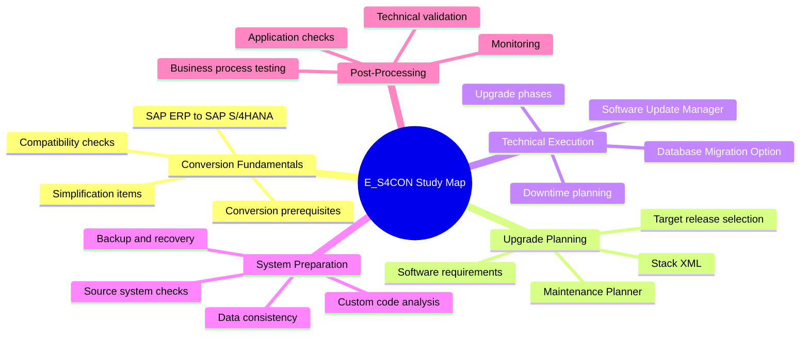
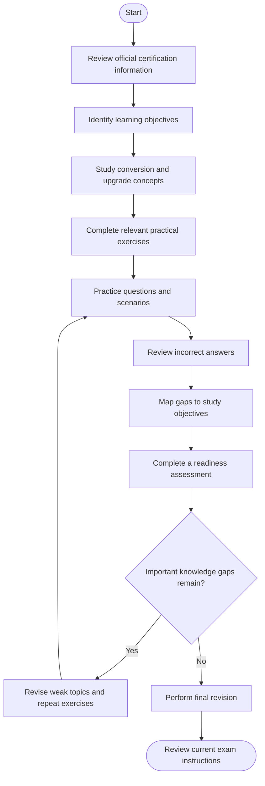
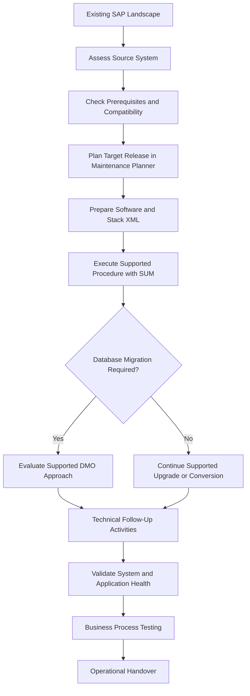
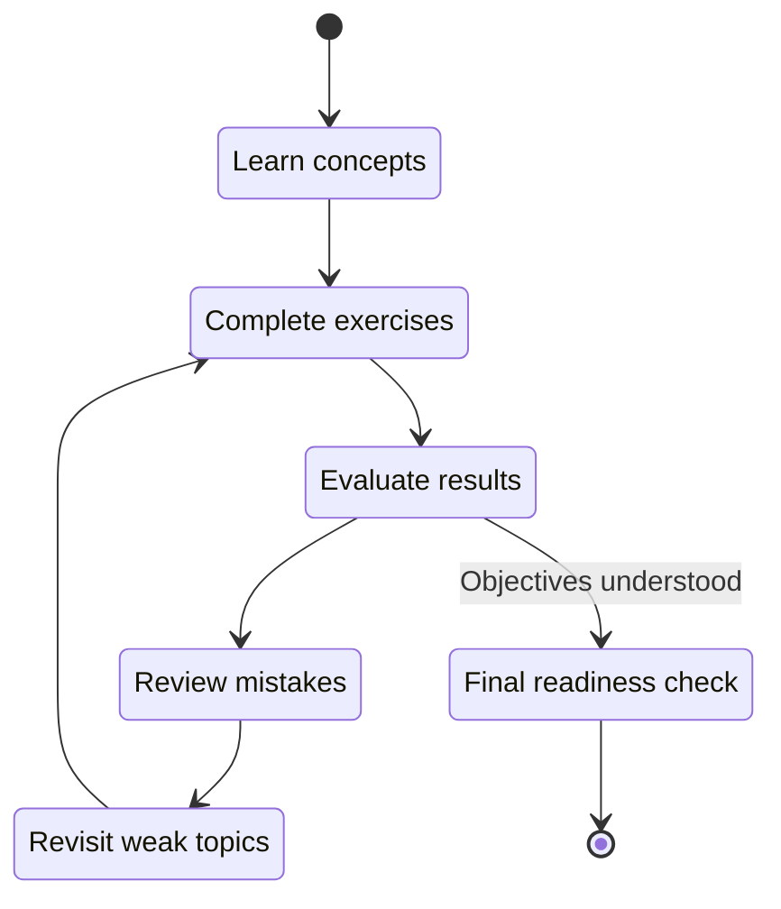
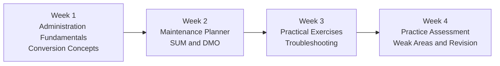

# SAP E_S4CON Study Guide: SAP S/4HANA Conversion and System Upgrade

Prepare for the **SAP Certified – SAP S/4HANA Conversion and SAP System Upgrade (E_S4CON)** certification with a structured learning path focused on system conversion, technical upgrades, SAP administration, migration planning, and post-upgrade validation.

This repository brings together technical explanations, Mermaid diagrams, revision strategies, and practical exercises to help learners understand how SAP S/4HANA conversion and upgrade projects work.

- **Certification code:** E_S4CON
- **Certification title:** SAP Certified – SAP S/4HANA Conversion and SAP System Upgrade
- **Provider:** SAP
- **CertsGate listing:** [E_S4CON Certification Preparation](https://certsgate.com/exams/sap/e_s4con)
- **Official learning journey:** [Converting and Upgrading SAP S/4HANA Systems](https://learning.sap.com/learning-journeys/converting-and-upgrading-sap-s-4hana-systems)

## Table of Contents

- [About the Certification](#about-the-certification)
- [Who Should Use This Guide?](#who-should-use-this-guide)
- [Core Technical Knowledge Areas](#core-technical-knowledge-areas)
- [Official Exam Objectives and Weightings](#official-exam-objectives-and-weightings)
- [Certification Preparation Flowchart](#certification-preparation-flowchart)
- [SAP Conversion and Upgrade Architecture](#sap-conversion-and-upgrade-architecture)
- [Understanding Key Technologies](#understanding-key-technologies)
- [Circular Study and Revision Cycle](#circular-study-and-revision-cycle)
- [Step-by-Step Preparation Guide](#step-by-step-preparation-guide)
- [Suggested Study Roadmap](#suggested-study-roadmap)
- [Practice Questions and Mock Tests](#practice-questions-and-mock-tests)
- [Hands-On Learning Projects](#hands-on-learning-projects)
- [Common Preparation Mistakes](#common-preparation-mistakes)
- [Career Relevance](#career-relevance)
- [Frequently Asked Questions](#frequently-asked-questions)
- [Official and Additional Learning Resources](#official-and-additional-learning-resources)
- [About CertsGate](#about-certsgate)

## About the Certification

The E_S4CON certification is associated with SAP S/4HANA conversion and SAP system upgrade knowledge. These activities are important when organizations need to move an existing SAP landscape to a supported software release or transition an SAP ERP system to SAP S/4HANA.

System conversion and system upgrade are related, but they are not identical:

- **System upgrade:** Moves an existing SAP system to a newer software release while retaining the same general system type.
- **SAP S/4HANA system conversion:** Transitions an existing SAP ERP system to SAP S/4HANA and includes additional technical and application-related conversion activities.
- **Database migration:** Moves system data from one supported database platform to another.
- **Post-conversion validation:** Confirms that the converted system is technically sound and that critical business processes continue to work.

SAP identifies system administration, installation and patching, and software logistics as relevant prerequisites for its conversion and upgrade learning journey. Review the current [official learning journey](https://learning.sap.com/learning-journeys/converting-and-upgrading-sap-s-4hana-systems) for its latest prerequisites and content.

## Who Should Use This Guide?

This study guide is useful for:

- SAP Basis administrators working with SAP system maintenance.
- SAP technical consultants preparing for conversion or upgrade projects.
- SAP system administrators responsible for software lifecycle activities.
- IT professionals learning about SAP S/4HANA transition approaches.
- Experienced SAP practitioners who want to organize their knowledge before certification.

A learner who already understands SAP system administration, SAP software installation, database fundamentals, and transport or maintenance processes will have a useful foundation.

If these topics are new, start with the relevant SAP training materials instead of jumping directly into practice questions.

## Core Technical Knowledge Areas

The following map is an **independent study overview**, not an official SAP exam-domain breakdown.

### 1. Conversion Fundamentals

Understand why an organization might convert an existing SAP ERP system instead of implementing a new system. Learn how system readiness, custom developments, data structures, supported releases, and business requirements influence conversion planning.

### 2. Upgrade Planning

Study how administrators identify a target release, check system requirements, plan software changes, and prepare the required installation media and configuration information.

### 3. Software Update Manager

Understand the role of **Software Update Manager (SUM)** in SAP software maintenance, upgrades, and conversion procedures. Learn the purpose of its preparation, execution, and follow-up phases.

### 4. Database Migration and DMO

Learn what the **Database Migration Option (DMO)** does and how it can combine database migration with software update activities in supported scenarios. Understand prerequisites and why not every system or migration scenario supports the same procedure.

### 5. Validation and Troubleshooting

Study how to identify preparation errors, investigate failed checks, review logs, verify technical system health, and confirm that important application functions work after an upgrade or conversion.

## Official Exam Objectives and Weightings

Before building a final revision checklist, use the current SAP certification details and its linked learning journey to identify the authoritative scope.

| Information | Recommended approach |
|---|---|
| Certification title and code | Confirm on the SAP certification page |
| Learning objectives | Use the linked SAP learning journey |
| Technical prerequisites | Review SAP's stated prerequisites |
| Exam duration and assessment format | Check the current certification details |
| Official domain percentages | Include only when SAP publishes them |
| Current system requirements | Consult the relevant SAP technical documentation |

**No official domain percentages are assigned in this guide.** The study map above groups related technical subjects to make revision easier; it does not indicate their relative importance or guarantee that every subject appears in the assessment.

For a reliable starting point, use the [SAP conversion and upgrade learning journey](https://learning.sap.com/learning-journeys/converting-and-upgrading-sap-s-4hana-systems) and follow the current certification information linked from SAP.

## Certification Preparation Flowchart

Use this process to turn the E_S4CON study guide into a repeatable preparation plan.

The important part is the feedback loop. A wrong answer should lead to a specific learning activity, such as reviewing SUM phases, checking conversion prerequisites, or revisiting the distinction between an upgrade and a conversion.

## SAP Conversion and Upgrade Architecture

The following is a **conceptual architecture** showing the major stages and tools involved in a typical conversion or upgrade. It is not a mandatory procedure for every SAP landscape. The actual sequence depends on the source system, target release, database, supported migration path, and project requirements.

### Main components and their roles

| Component | Purpose |
|---|---|
| Source SAP system | The existing environment being maintained or converted |
| Maintenance Planner | Helps plan supported software changes and generate the required planning information |
| Software Update Manager | Performs supported software update, upgrade, and conversion activities |
| Database Migration Option | Supports combined software-update and database-migration scenarios where applicable |
| SAP technical documentation | Provides prerequisites, procedures, compatibility information, and troubleshooting guidance |
| Validation procedures | Help verify system stability and business functionality after the change |

For details, consult SAP's [Software Update Manager and conversion learning material](https://learning.sap.com/courses/technical-implementation-and-operation-ii-of-sap-s-4hana-and-sap-business-suite/sap-system-upgrade-and-sap-s-4hana-conversion-1).

## Understanding Key Technologies

### Maintenance Planner

Maintenance Planner is used to plan software changes based on the existing SAP landscape and the intended target. Learn how to select a target release, review planned components, and understand the information required for the next technical steps.

### Software Update Manager (SUM)

SUM is central to SAP software maintenance. Understand its major phases and the checks that must be completed before proceeding. Learn to distinguish preparation errors from execution problems and follow-up issues.

### Database Migration Option (DMO)

DMO can combine a software update with database migration in supported scenarios. Study the prerequisites, supported source and target configurations, and the difference between a standard upgrade and a procedure that also changes the database.

### Simplification Items and Custom Code

Conversion preparation includes checking compatibility and identifying application changes that may affect existing functionality. Learn why custom developments and simplification requirements need attention before the technical conversion begins.

### Backups, Recovery, and Validation

A technically completed upgrade is not the same as a fully validated system. Understand backup planning, recovery considerations, technical checks, application verification, and the importance of testing critical business processes.

## Circular Study and Revision Cycle

Certification preparation works best as a continuous cycle, not a one-time reading exercise.

Use the cycle after each major topic. For example, after studying DMO, explain its purpose in your own words, work through an appropriate example, identify anything you cannot explain, revisit the relevant SAP documentation, and repeat the exercise.

## Step-by-Step Preparation Guide

### Step 1: Read the Official Learning Journey

Start with [Converting and Upgrading SAP S/4HANA Systems](https://learning.sap.com/learning-journeys/converting-and-upgrading-sap-s-4hana-systems).

Create a checklist of the objectives and practical activities shown in the current material. Avoid relying exclusively on old notes because SAP releases, supported procedures, and system requirements can change.

### Step 2: Strengthen SAP Administration Fundamentals

Review the relevant topics in system administration, installation and patching, and software logistics. Focus on understanding how the SAP landscape, software components, database, and operating environment interact.

### Step 3: Learn the Difference Between Conversion and Upgrade

Be able to explain:

- What changes during an SAP system upgrade.
- What additional activities are involved in an SAP S/4HANA conversion.
- Why prerequisites and compatibility checks matter.
- When database migration becomes part of the overall procedure.

### Step 4: Study Planning and Preparation

Practice explaining how a technical team prepares for a software change. Include target-release selection, supported configurations, system checks, required software, custom-code considerations, backup planning, and downtime coordination.

### Step 5: Understand SUM and DMO

Study the purpose of each tool and the stages in which it is used. Draw your own process diagram from the official documentation and explain each stage without copying the source text.

### Step 6: Work Through Practical Scenarios

Use an authorized SAP training system or sandbox when available. Follow documented exercises, examine the outputs, and learn how to investigate errors safely.

Do not attempt a production conversion or upgrade simply to practice. These activities require a supported procedure, appropriate permissions, backups, and a carefully managed change plan.

### Step 7: Test and Revisit Weak Areas

Use original practice questions and scenario-based exercises to identify knowledge gaps. For each incorrect answer, write down the relevant topic, why your answer was wrong, and which official material will help you correct the misunderstanding.

### Step 8: Complete Final Revision

Review your objective checklist, key tool responsibilities, prerequisite checks, conversion-versus-upgrade distinctions, and validation steps. Confirm the latest assessment format and instructions on SAP's certification platform.

## Suggested Study Roadmap

This is an **illustrative four-week plan**, not an official SAP timetable. Adjust it to your current experience and the scope of the current learning journey.

| Week | Main focus | Suggested outcome |
|---|---|---|
| 1 | SAP administration and conversion fundamentals | Explain the core concepts and prerequisites |
| 2 | Maintenance Planner, SUM, upgrades, and DMO | Describe the planning and execution workflow |
| 3 | Practical exercises and troubleshooting | Understand checks, logs, dependencies, and validation |
| 4 | Practice questions and revision | Identify remaining gaps and review official material |

A simple weekly routine is to study a concept, summarize it, perform a related exercise where possible, and then test your understanding. Keep a separate list of unresolved questions to revisit.

## Practice Questions and Mock Tests

Practice questions can help reinforce technical knowledge, but they should support—not replace—official learning materials.

Use them to assess whether you can explain the underlying reasoning rather than recognize a familiar answer.

### Original practice questions

These questions are created for learning and are not represented as official SAP exam questions.

**Question 1: What is the main difference between a system upgrade and an SAP S/4HANA conversion?**

A. A system upgrade always changes the database vendor.  
B. A system conversion changes the system from SAP ERP to SAP S/4HANA and involves additional conversion activities.  
C. A system upgrade never requires preparation.  
D. Both terms always describe exactly the same process.

**Answer:** B.

**Explanation:** A system upgrade moves an existing system to a newer software release. A conversion from SAP ERP to SAP S/4HANA involves additional technical and application-related changes.

**Question 2: What is the purpose of Maintenance Planner in a software-change project?**

A. To replace all post-upgrade testing.  
B. To execute every application-level business test automatically.  
C. To plan supported software changes for an SAP landscape.  
D. To eliminate the need for system prerequisites.

**Answer:** C.

**Explanation:** Maintenance Planner supports software-change planning. It does not remove the need for prerequisite checks, execution planning, or post-change validation.

**Question 3: What does DMO help accomplish in supported scenarios?**

A. It combines software-update activities with database migration.  
B. It replaces every backup and recovery process.  
C. It guarantees that all custom code is compatible.  
D. It removes the need to verify the target configuration.

**Answer:** A.

**Explanation:** The Database Migration Option supports combined software-update and database-migration scenarios when the relevant prerequisites and supported configurations are met.

### How to use practice questions effectively

1. Attempt each question before looking at the explanation.
2. Explain why the correct answer is appropriate.
3. Review why the other options are incorrect.
4. Map mistakes to the corresponding official learning objective.
5. Revisit the relevant documentation and repeat the exercise.
6. Use a mock test to find remaining gaps—not to predict a guaranteed result.

For additional independent preparation material, visit [CertsGate E_S4CON](https://certsgate.com/exams/sap/e_s4con). Check the scope and currency of any third-party resource against SAP's official material.

## Hands-On Learning Projects

The following exercises are learning projects. They are not claims about specific tasks in the certification assessment.

### Project 1: Build a Conversion Readiness Checklist

Create a checklist covering:

- Source-system release and supported target.
- Relevant SAP prerequisites and compatibility checks.
- Custom-code and simplification considerations.
- Database and operating-system requirements.
- Backup and recovery planning.
- Required software and maintenance information.
- Post-conversion testing.

**Goal:** Explain why each check matters and what evidence a project team would review before proceeding.

### Project 2: Draw a SUM Workflow

Create a diagram that describes the preparation, execution, and follow-up stages of a software change. Add the relevant checks, dependencies, and documentation links.

**Goal:** Explain the purpose of each stage and why unresolved errors must be addressed before continuing.

### Project 3: Compare Upgrade and Conversion Scenarios

Prepare a table comparing a release upgrade, an SAP ERP-to-SAP S/4HANA conversion, and a database migration.

**Goal:** Distinguish the purpose, prerequisites, and additional considerations of each activity.

### Project 4: Design a Post-Change Validation Plan

Draft a validation checklist for a hypothetical training landscape. Include technical health checks, application availability, critical business-process testing, error monitoring, and handover documentation.

**Goal:** Demonstrate that successful execution must be followed by appropriate verification.

Use only authorized environments and follow the documentation applicable to the actual SAP version and landscape.

## Common Preparation Mistakes

### Memorizing abbreviations without understanding the workflow

Knowing the names SUM, DMO, and Maintenance Planner is not enough. Be able to explain how the tools relate to a software-change project.

### Confusing an upgrade with a conversion

This distinction affects the preparation, technical activities, and validation requirements. Review it until you can explain it clearly without notes.

### Ignoring prerequisites

Supported source releases, target compatibility, database requirements, and other technical conditions influence which procedures are possible.

### Treating a completed procedure as proof of business readiness

A system may require follow-up activities and application testing after the technical work finishes. Include validation in every practice scenario.

### Relying only on practice questions

Questions help reveal gaps, but they cannot replace current SAP documentation, practical learning, or an understanding of the relevant technical processes.

### Using outdated material without checking the release

Technical procedures can change. Verify important details against the current SAP Help Portal, learning journey, and relevant guides before treating older notes as authoritative.

## Career Relevance

Knowledge of SAP S/4HANA conversion and system upgrades can support technical work involving:

- SAP Basis and system administration.
- SAP technical upgrade planning.
- System conversion readiness assessments.
- Software lifecycle management.
- Database migration planning.
- Technical validation and troubleshooting.
- SAP S/4HANA transition projects.

The practical value of this knowledge depends on your experience, the SAP landscapes you work with, and the requirements of the roles you pursue. Certification preparation is most useful when paired with hands-on skills and a clear understanding of production change-management practices.

## Frequently Asked Questions

### What is the E_S4CON certification?

E_S4CON is listed as the SAP Certified – SAP S/4HANA Conversion and SAP System Upgrade certification. Confirm the current title and certification details through SAP's official certification resources.

### What should I study for E_S4CON?

Start with the official conversion and upgrade learning journey. Relevant subjects include SAP administration prerequisites, conversion concepts, software-change planning, Maintenance Planner, SUM, DMO, system preparation, and validation. Use the current official objectives to determine the exact scope.

### Is E_S4CON only about SAP S/4HANA conversion?

No. The certification title covers both SAP S/4HANA conversion and SAP system upgrade. Your preparation should distinguish these activities and understand their related tools and prerequisites.

### How long should I prepare?

There is no single suitable duration for every candidate. Your preparation time depends on your SAP administration experience, familiarity with conversion tools, access to practical exercises, and progress against the official learning objectives.

### Are the exam duration, question count, and passing score published?

Check the current official certification page for these details. Do not rely on an unverified third-party listing as confirmation of current exam policies.

### Can practice questions replace hands-on preparation?

No. Practice questions can help you evaluate your understanding, but they do not replace official documentation, relevant learning activities, or practical work.

### Where can I find official study materials?

Begin with SAP's [Converting and Upgrading SAP S/4HANA Systems learning journey](https://learning.sap.com/learning-journeys/converting-and-upgrading-sap-s-4hana-systems), then use the documentation linked from the relevant lessons.

## Official and Additional Learning Resources

Use official SAP resources as the foundation of your E_S4CON preparation.

| Resource | How it helps |
|---|---|
| [SAP Conversion and Upgrade Learning Journey](https://learning.sap.com/learning-journeys/converting-and-upgrading-sap-s-4hana-systems) | Main learning path for conversion and upgrade concepts |
| [SAP System Upgrade and SAP S/4HANA Conversion](https://learning.sap.com/courses/technical-implementation-and-operation-ii-of-sap-s-4hana-and-sap-business-suite/sap-system-upgrade-and-sap-s-4hana-conversion-1) | Explains upgrade planning, SUM, and conversion fundamentals |
| [Understanding Upgrade and Conversion Concepts](https://learning.sap.com/courses/sap-s-4hana-conversion-and-sap-system-upgrade/understanding-the-concept-of-an-upgrade-and-an-sap-s-4hana-conversion) | Helps distinguish upgrade and conversion approaches |
| [Planning a Software Change](https://learning.sap.com/courses/sap-s-4hana-conversion-and-sap-system-upgrade/planning-a-software-change) | Covers Maintenance Planner and planning activities |
| [SAP Help Portal](https://help.sap.com/) | Technical documentation and product-specific guidance |
| [SAP Certification](https://learning.sap.com/certifications) | Browse current certification information |
| [CertsGate E_S4CON Preparation Page](https://certsgate.com/exams/sap/e_s4con) | Independent supplementary preparation material |

Before applying a procedure, confirm that the documentation matches your source release, target release, database, and deployment scenario.

## About CertsGate

[CertsGate](https://certsgate.com/) is an independent IT certification preparation resource that offers exam-oriented study materials and practice resources across multiple technology vendors.

For E_S4CON, candidates can explore the [CertsGate E_S4CON page](https://certsgate.com/exams/sap/e_s4con) for supplementary preparation material and knowledge checks.

Use third-party resources to reinforce concepts, identify weak areas, and structure revision. Compare technical explanations with current SAP documentation, and do not assume that third-party practice questions are actual or authorized certification questions.

